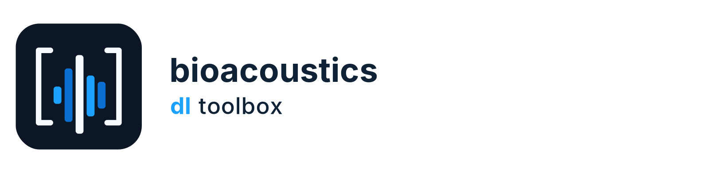

<p align="center">
  <picture>
    <source media="(prefers-color-scheme: dark)" srcset="assets/branding/png/lockup-inverse.png">
    
  </picture>
</p>

<p align="center"><strong>Practical deep-learning building blocks for turning environmental sound into reproducible predictions.</strong></p>

Bioacoustics DL Toolbox is a standalone Python/PyTorch library for bioacoustic
machine learning. It brings audio preprocessing, spectrogram datasets,
classifiers, metrics, training utilities, checkpointing, and sliding-window
prediction into one reusable package.

It is designed for researchers and engineers who need the core modeling tools
without taking on a desktop application, workflow manager, database, or user
interface.

## What you can do

- Prepare consistent linear, mel, or MFCC features from audio recordings.
- Train binary, multiclass, or explicitly configured multilabel classifiers.
- Evaluate predictions with standard and multilabel metrics.
- Run reproducible sliding-window inference over complete recordings.
- Export predictions as Raven-compatible selection tables when needed.
- Save model weights with the established `trained_model.pt` format and
  optional metadata for reproducible inference.

## Install

The supported Python versions are 3.11–3.13. From a checkout of this
repository:

```bash
python -m pip install -e .
```

Install optional random-forest features with:

```bash
python -m pip install -e '.[rf]'
```

Install TensorBoard summaries and visualization helpers with:

```bash
python -m pip install -e '.[summaries,visualization]'
```

For all optional features and the test tools:

```bash
python -m pip install -e '.[rf,summaries,visualization,test]'
```

## A typical workflow

1. Configure the sample rate, spectrogram representation, normalization, and
   classification task.
2. Build a `SpectrogramDataset` for training and validation.
3. Create a model from the reusable encoder and classifier components, then
   train it with `Trainer`.
4. Use `predict_windows` to apply the trained model to a recording and retain
   timestamps, probabilities, and labels.
5. Pass those results to `write_raven_tsv` for optional annotation-table export.

The main public areas are:

| Area | Use it for |
| --- | --- |
| `bioacoustics_dl_toolbox.audio` | Audio loading, transforms, datasets, and PCM WAV segments |
| `bioacoustics_dl_toolbox.models` | Encoders, classifier blocks, and model utilities |
| `bioacoustics_dl_toolbox.training` | Training loops, checkpoints, and early stopping |
| `bioacoustics_dl_toolbox.metrics` | Classification and multilabel evaluation |
| `bioacoustics_dl_toolbox.prediction` | Headless windowed prediction and Raven export |
| `bioacoustics_dl_toolbox.visualization` | Optional plots and image summaries |

## Classification and prediction

`TaskConfig` makes the learning task explicit. The default `auto` mode keeps
two-class classification as binary classification with two raw logits and
uses multiclass behavior for larger class sets. Multilabel classification is
explicit: use `TaskConfig(task_type="multilabel")` when a recording can carry
several class labels at once.

Use one validated `class_to_index` mapping for datasets, metrics, prediction,
and checkpoints. Binary and multiclass predictions use softmax and one
selected class. Multilabel predictions use independent sigmoid probabilities
and configurable per-class thresholds; probabilities and decisions remain
separate.

For training and prediction, use the same `SpectrogramConfig`,
`NormalizationConfig`, and audio window length. The shared deterministic
preprocessing path keeps feature representations aligned, including the
MFCC path, which does not apply a second decibel conversion.

```python
from bioacoustics_dl_toolbox import TaskConfig

task = TaskConfig(task_type="multilabel")
```

The reusable predictor returns structured window records with class-named
probabilities, selected labels, sample positions, and recording-relative
timestamps. It does not merge windows into behavioral events. Raven export is
an optional downstream adapter, and merging overlapping windows is opt-in.

## Checkpoints

By default, `save_model` writes the established six-key `trained_model.pt`
payload. A versioned metadata mapping can additionally record task type,
normalization, window and hop lengths, thresholds, and ordered class names so
new inference runs can be reproduced more reliably. Resume checkpoints used
by `Trainer` are separate from exported model files.

## Roadmap

The next planned release is **v0.2.0**. Its focus is a dependable, task-aware
library for real bioacoustic experiments:

- reliable CSV splitting and shared training/inference preprocessing;
- explicit task contracts and multilabel datasets, training, metrics, and
  thresholds;
- reusable sliding-window prediction and optional Raven selection-table
  export;
- reproducible checkpoint metadata and safer binary class mappings.

The detailed workstream plan is in [`0.2_VERSION.md`](0.2_VERSION.md), while
[`RELEASE_NOTES.md`](RELEASE_NOTES.md) records what is complete in the current
working copy. The release is not considered shipped until the version and
release notes are updated accordingly.

## Development

Development and maintenance checks are intentionally kept below the user
documentation. Install the test dependencies with:

```bash
python -m pip install -e '.[test]'
```

Run the unit tests and lint checks with:

```bash
python -m pytest
python -m ruff check src tests
python -m ruff format --check src tests
```

For v0.2.0, tests are deterministic CPU-based unit tests only; do not add
integration, end-to-end, GPU, network, or real-recording tests. Detailed
implementation guidance lives in [`specs/0.2/`](specs/0.2/).

## License and attribution

This project is [GPL-3.0-only](LICENSE). It contains adapted ANIMAL-SPOT
material and was extracted from
[`alpaca-pipelines`](https://github.com/darizae/alpaca-pipelines); see
[`NOTICE.md`](NOTICE.md) for attribution and citation details.

The branding assets are kept in [`assets/branding/`](assets/branding/). The
bundle includes light and dark lockups, the Spectral Grid mark, application
icons, and vector source files.
